# Vi's Quick Ball - An Assistive Floating Touch Ball
<table>
  <tr>
    <td rowspan="3" width="100" align="center" valign="middle">
      
    </td>
    <td>
      <h1>Vi's Quick Ball</h1>
    </td>
  </tr>
  <tr>
    <td>
      <strong>An Assistive Floating Touch Ball</strong>
    </td>
  </tr>
  <tr>
    <td>
      <sub>Compatibility: Android 8.1+ (API 27+)</sub>
    </td>
  </tr>
</table>
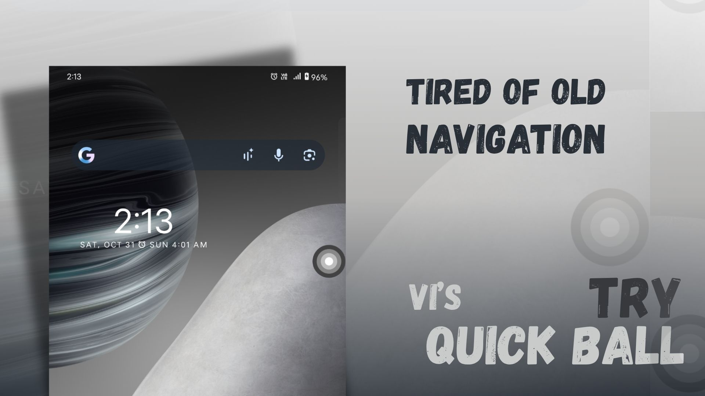

Vi's Quick Ball is a native Android assistive navigation utility. Its floating concentric-circle ball requests Back on tap, Home on double-tap, and Recent Apps on long-press, and can be dragged to dock at a screen edge. Android or a device manufacturer may restrict Recent Apps or background behavior.

🌐 **Official Website:** https://ahamviraj.github.io/visquickball/

🔒 **Privacy Policy:** https://ahamviraj.github.io/visquickball/privacy-policy.html

**Current project release:** 1.0.0  
**Package ID:** `com.viraj.viquickball`

## Developer

- Developer: **Viraj**
- Display name: **Aham Viraj**
- Email: [ahamviraj@gmail.com](mailto:ahamviraj@gmail.com)
- GitHub: [ahamviraj](https://github.com/ahamviraj)
- Official website: [Vi's Quick Ball](https://ahamviraj.github.io/visquickball/)
- Privacy policy: [Privacy Policy](https://ahamviraj.github.io/visquickball/privacy-policy.html)
- Instagram: [@ahamveeraj](https://www.instagram.com/ahamveeraj/)
- Project repository: [ahamviraj/visquickball](https://github.com/ahamviraj/visquickball)

## Version

The current project release label is **1.0.0**. The Android app configuration in `app/build.gradle.kts` currently has `versionName = "1.0"` and `versionCode = 1`. This discrepancy is documented here; the Android release configuration was not changed. No public download is claimed here.

## Features

- Four-layer gray and white floating ball with a small press animation.
- Drag to the nearest screen edge; dock position is stored locally.
- Optional Android Quick Settings tile and home-screen widget.
- Setup dashboard for overlay and Accessibility Service permissions.
- Privacy policy available in the app offline and in `website/privacy-policy.html`.
- No ads or advertising SDK in the inspected project.

## Promotional Slides

<p align="center"><a href="slides/1.jpg"></a></p>
<p align="center"><a href="slides/2.jpg">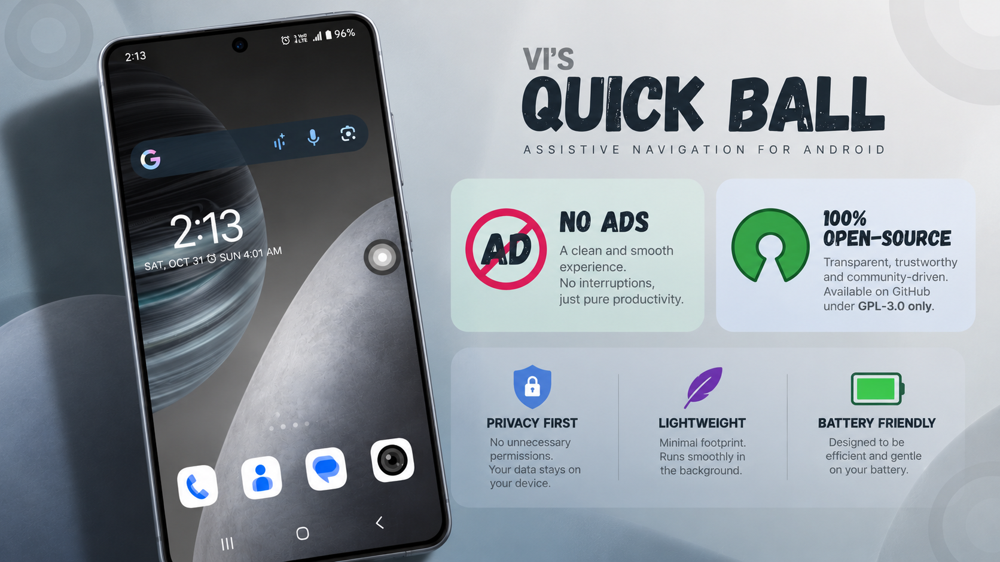</a></p>
<p align="center"><a href="slides/3.jpg">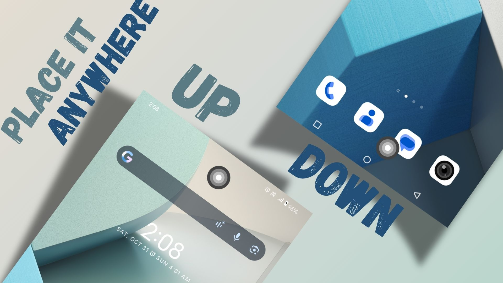</a></p>
<p align="center"><a href="slides/4.jpg">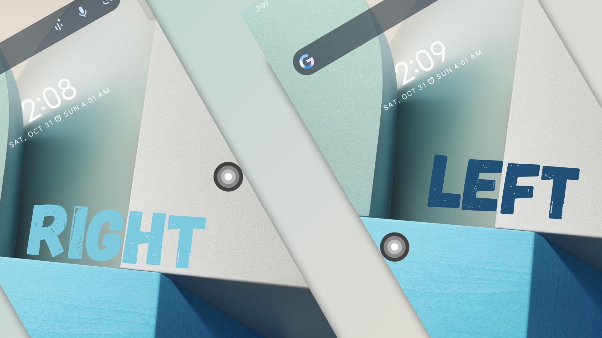</a></p>
<p align="center"><a href="slides/5.jpg">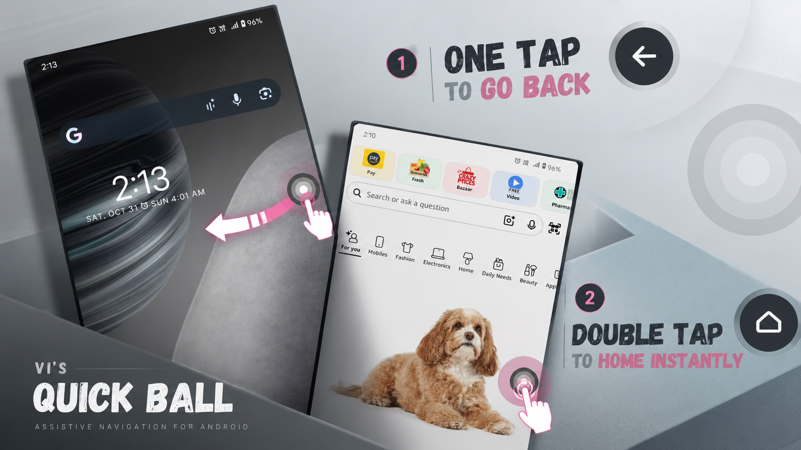</a></p>
<p align="center"><a href="slides/6.jpg">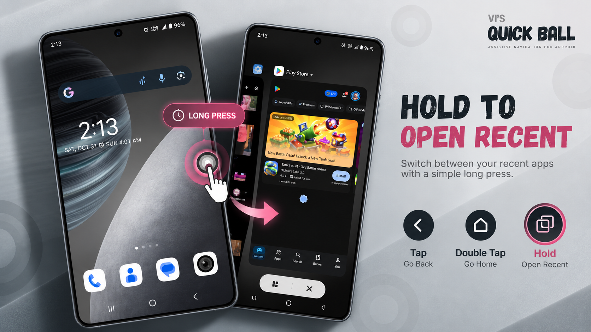</a></p>
<p align="center"><a href="slides/7.jpg">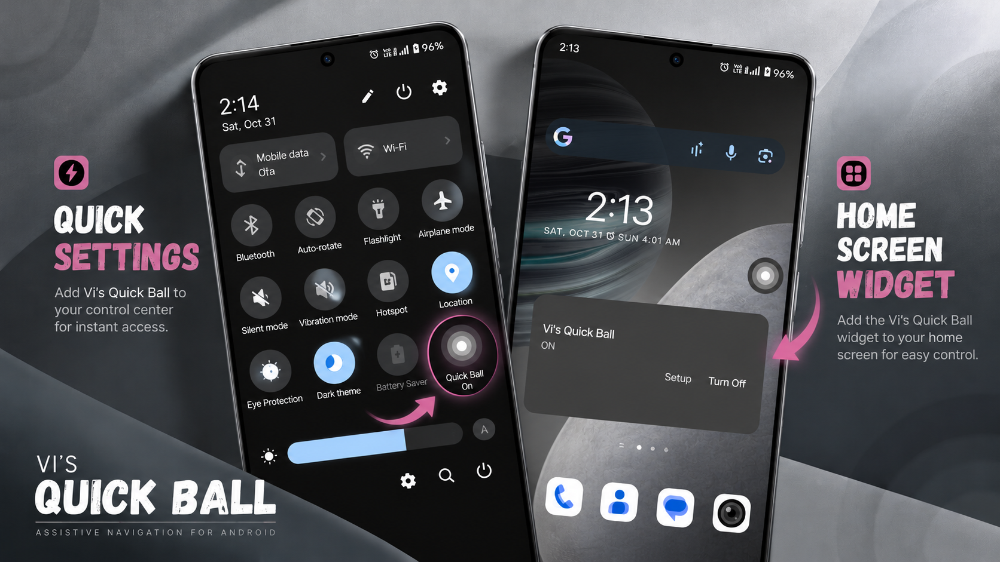</a></p>

## Screenshots

<p align="center"><a href="screenshots/back.png">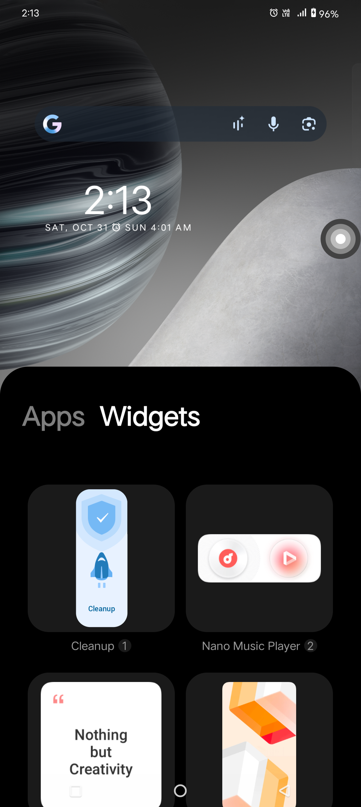</a> <a href="screenshots/dog.png">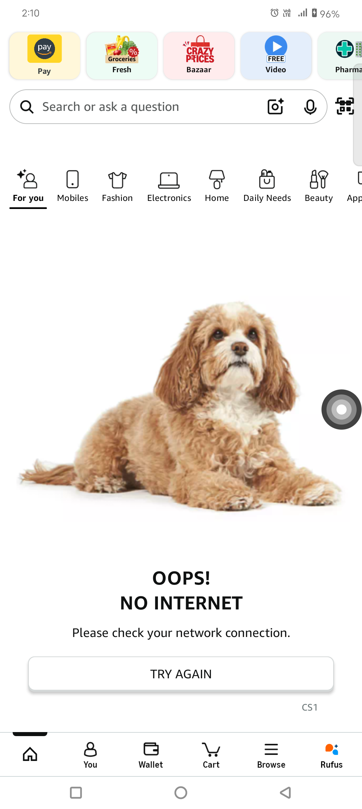</a> <a href="screenshots/down.png">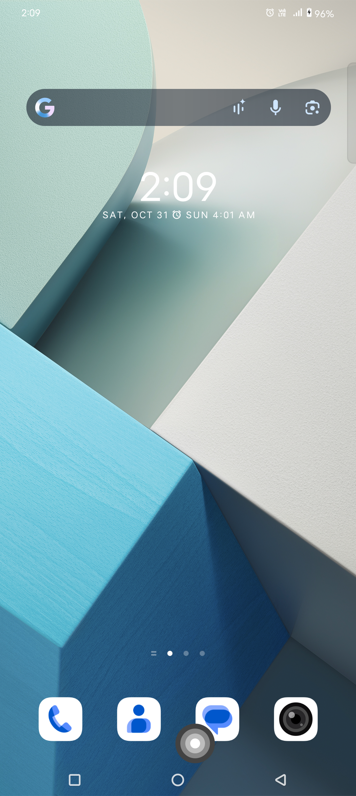</a> <a href="screenshots/files.png">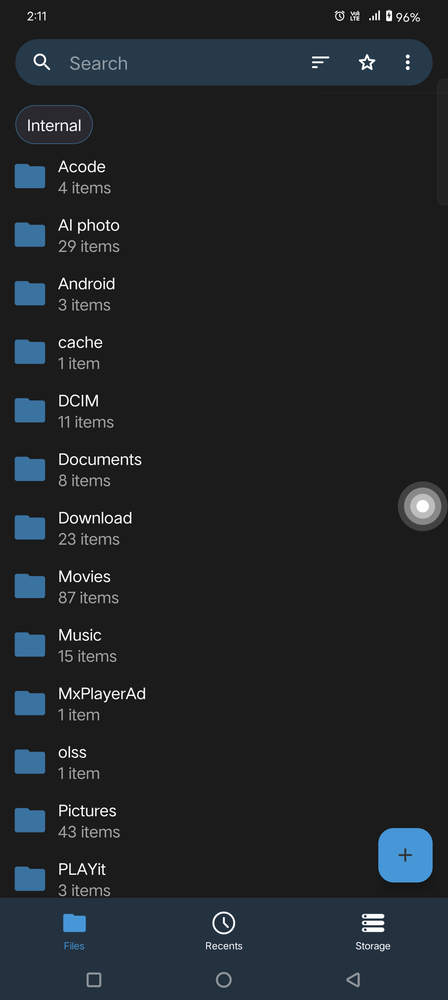</a></p>
<p align="center"><a href="screenshots/gallery.png">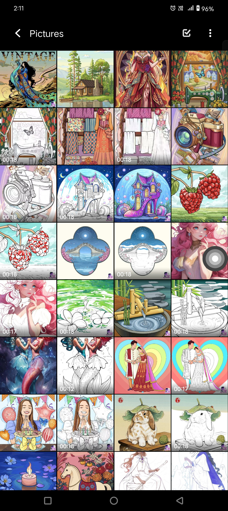</a> <a href="screenshots/left.png">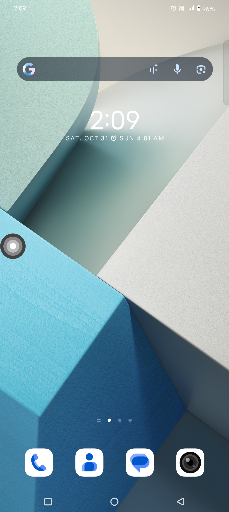</a> <a href="screenshots/main.png">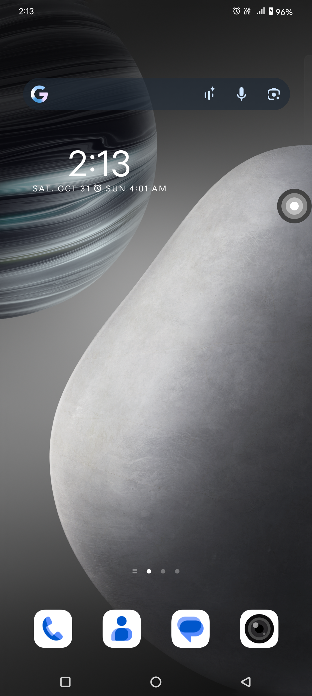</a> <a href="screenshots/recent.png">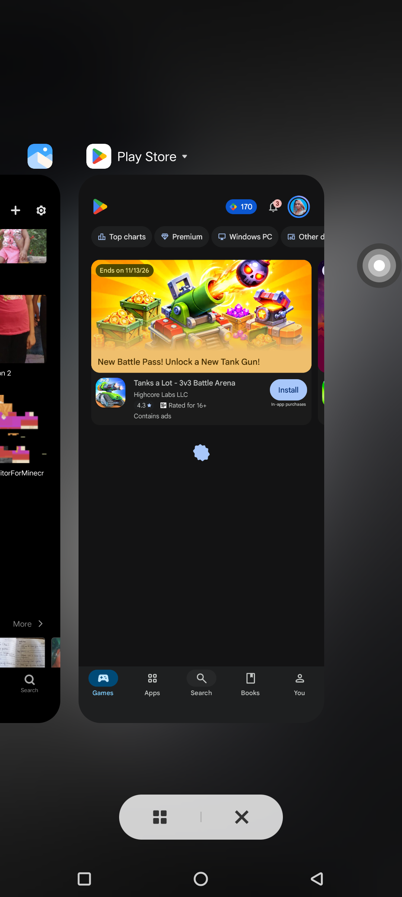</a></p>
<p align="center"><a href="screenshots/right.png">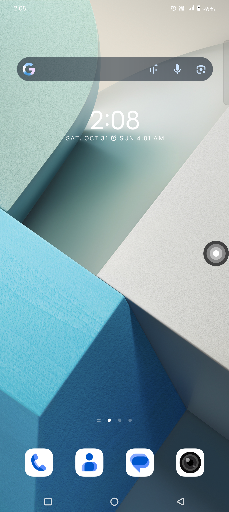</a> <a href="screenshots/shortcut_in_Quick_Tiles_main.png">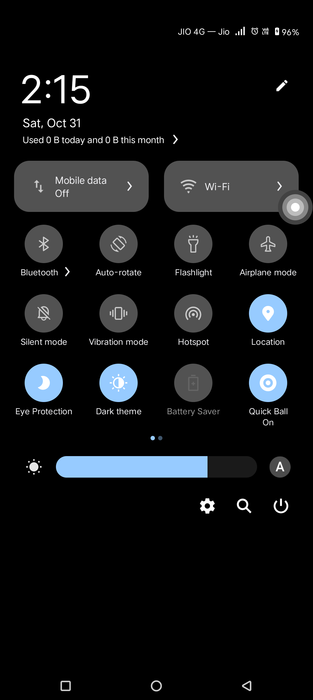</a> <a href="screenshots/shortcut_in_Quick_Tiles.png">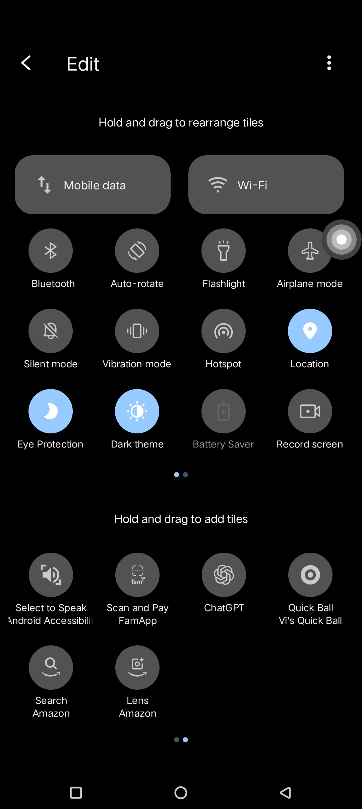</a> <a href="screenshots/up.png">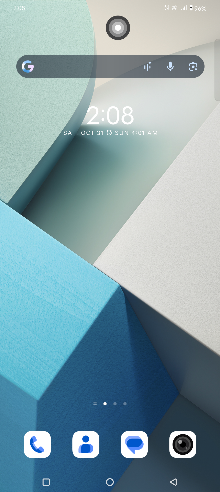</a></p>
<p align="center"><a href="screenshots/widget_on_home.png">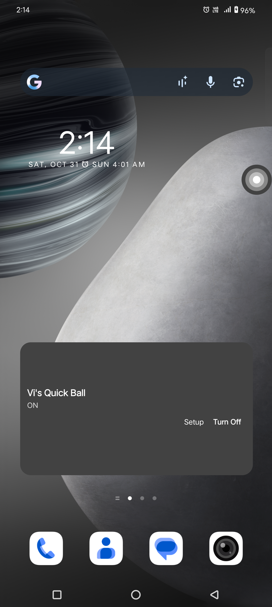</a> <a href="screenshots/widget.png">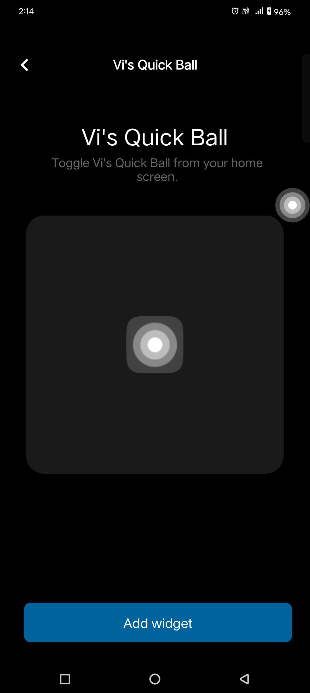</a></p>

## Permissions

- **Display over other apps:** shows the floating ball above ordinary apps.
- **Accessibility Service:** requests Back, Home, and Recent Apps actions and observes window package/class metadata to detect some system panels. It does not retrieve accessibility nodes or window text.

Both permissions are enabled manually in Android Settings. The Android app currently declares no Internet permission and has no app-initiated network requests. See [Privacy Policy](PRIVACY_POLICY.md) for the verified data-handling details.

## Build the Android app

Open this project in Android Studio or run the existing Windows Gradle wrapper from the repository root:

```powershell
.\gradlew.bat assembleDebug
```

The debug APK is normally at `app/build/outputs/apk/debug/app-debug.apk`. Release builds use the existing external `keystore.properties` and signing key configuration. Do not add signing credentials or keystores to source control.

## Preview the website

From the repository root:

```powershell
python -m http.server 8000 --directory website
```

Then open `http://localhost:8000`. Website details and hosting instructions are in [website/README.md](website/README.md).

## Publish the static website

The website is static HTML/CSS/JavaScript and needs no backend. GitHub Pages is prepared through `.github/workflows/pages.yml`; configure **Settings → Pages → Source → GitHub Actions** after publishing the repository. Vercel can serve the site with `website/` as its project root, no build command, and `.` as output directory. See [website/README.md](website/README.md) for steps.

The website is prepared for Vercel at `website/` as its project root. No website has been deployed, and no public app download or store listing is configured yet.

## Configure the canonical policy URL

After you publish and verify the policy page, set the real HTTPS URL in `app/src/main/java/com/viraj/viquickball/PrivacyPolicyConfig.kt` (`CANONICAL_URL`). Rebuild and sign the app release. Before publishing the website, fill verified download, support email, and repository destinations in `website/site-config.js`; empty configuration values intentionally render explanatory text instead of fake links.

## Privacy and publication

- The developer contact and repository links are now configured with the supplied details.
- Add a verified app listing/download URL only after publication.
- After hosting, copy the final canonical HTTPS Privacy Policy URL into the Android app configuration and the Indus Appstore dashboard.
- Recheck the policy if dependencies, network access, or data handling change.

To report a privacy concern, email [ahamviraj@gmail.com](mailto:ahamviraj@gmail.com). The published policy is available at [ahamviraj.github.io/visquickball/privacy-policy.html](https://ahamviraj.github.io/visquickball/privacy-policy.html).

## License

Vi's Quick Ball is distributed under the **GNU General Public License v3.0 only** (`GPL-3.0-only`). See the repository's [LICENSE](LICENSE) file for the complete license terms. This is version 3 only; it does not grant use under later GPL versions.

Third-party libraries and platform components remain subject to their respective licenses. The project license does not change those terms.
